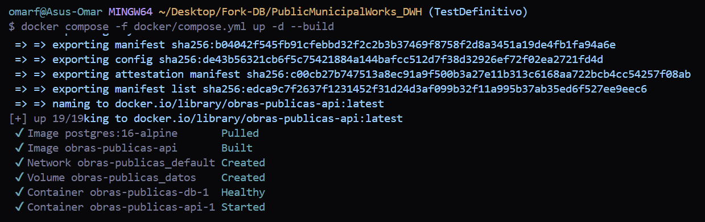
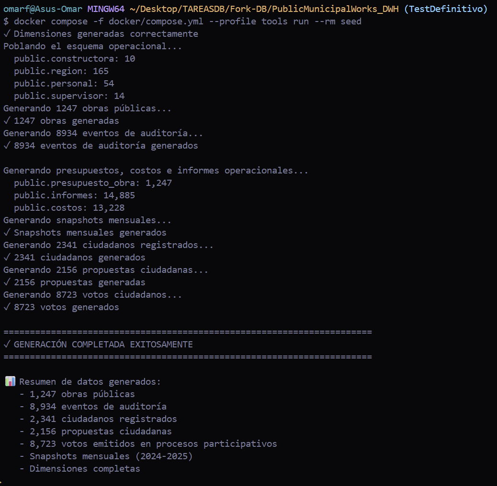
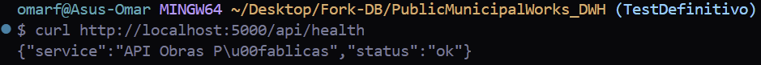
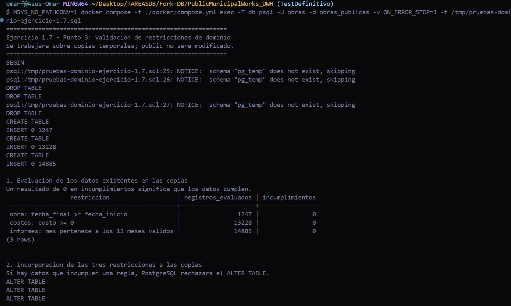
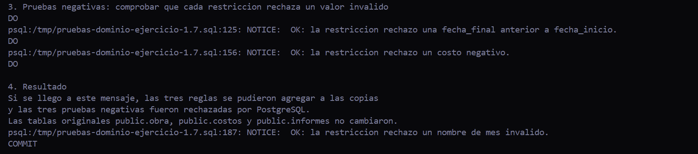

# Pruebas del proyecto asignado — Ejercicio 1.7

Este documento reúne las instrucciones para levantar la base de datos del proyecto asignado y ejecutar el punto 3 del ejercicio 1.7. La instalación sigue la sección **Running the reference API** del README de la rama TestDefinitivo. Las tres restricciones nuevas se prueban sobre copias temporales para no modificar las tablas originales.

---

## 1. Preparación y ejecución de la base de datos

### Credenciales y configuración local

En la rama TestDefinitivo, el archivo docker/compose.yml define estos valores predeterminados:

| Parámetro | Valor |
|---|---|
| Base de datos | obras_publicas |
| Usuario PostgreSQL | obras |
| Contraseña PostgreSQL | obras_local |
| Puerto PostgreSQL dentro del contenedor | 5432 |
| Puerto publicado en la computadora | 55432 |
| API | http://localhost:5000 |

### Iniciar PostgreSQL y la API

Desde la raíz del repositorio, ejecutar:

~~~bash
docker compose -f ./docker/compose.yml up -d --build
~~~

El comando construye la imagen de la API cuando sea necesario e inicia PostgreSQL y Flask. 

### Cargar las cuentas de demostración y los datos sintéticos

Ejecutar el servicio de población:

~~~bash
docker compose -f ./docker/compose.yml --profile tools run --rm seed
~~~

El servicio seed ejecuta los scripts de población del repositorio. Crea las cuentas de demostración y genera la población sintética de las tablas operacionales y del almacén dimensional.

### Comprobar la API

Ejecutar:

~~~bash
curl http://localhost:5000/api/health
~~~

La API debe responder con el estado de salud del servicio.

## 2. Restricciones de dominio que ya declara el esquema

La revisión se realiza sobre el esquema operacional de db/DDLBASEObPub.sql.

El esquema ya declara, entre otras, estas restricciones:

- personal.rol: limita el rol a Supervisor, Director, Secretario o Proyectista.
- informes.porcentaje_avance_fisico: exige un valor entre 0 y 100.
- informes.porcentaje_avance_presupuestario: exige un valor entre 0 y 100.

También se identifican atributos para los que no hay una validación de dominio equivalente, como las fechas de inicio y finalización de una obra, el costo de un gasto y el mes de un informe.

---

## 3. Tres restricciones de dominio propuestas y probadas en una copia

Se proponen las siguientes reglas adicionales:

| Núm. | Tabla y atributo(s) | Restricción propuesta | Justificación |
|---:|---|---|---|
| 1 | obra.fecha_inicio, obra.fecha_final | fecha_final >= fecha_inicio | La fecha de finalización no debe ser anterior a la fecha de inicio de la obra. |
| 2 | costos.costo | costo >= 0 | Un costo o gasto no debe almacenar importes negativos. |
| 3 | informes.mes | El valor debe pertenecer a los doce meses válidos en español. | Evita nombres de meses inexistentes o errores de escritura. |

### 3.1. Relación con los datos generados

El generador scripts/generate_synthetic_data.py permite anticipar el comportamiento de estas reglas:

1. Para las obras genera una fecha de inicio y suma una duración de entre 90 y 730 días para obtener la fecha final.
2. Inserta un costo solamente cuando el importe calculado para el periodo es mayor que cero.
3. Obtiene el nombre del mes de los informes de una lista que contiene los doce meses en español.

Estas observaciones describen la lógica del generador. El cumplimiento efectivo se comprueba con los registros cargados en la instancia local mediante el script SQL.

### 3.2. Archivo SQL

El archivo de pruebas es:

[practica4/proyecto-asignado/pruebas-dominio-ejercicio-1.7.sql](./pruebas-dominio-ejercicio-1.7.sql)

El script:

1. Crea copias temporales de public.obra, public.costos y public.informes.
2. Copia los registros existentes.
3. Cuenta los registros evaluados y los posibles incumplimientos de cada regla.
4. Agrega las tres restricciones CHECK únicamente a las copias.
5. Intenta una actualización inválida por cada restricción.
6. Comprueba que PostgreSQL rechace las tres operaciones.

Las tablas originales de public no se modifican. Las tablas temporales desaparecen al terminar la sesión de PostgreSQL.

### 3.3. Copiar el archivo SQL al contenedor

Desde la raíz del repositorio del fork creado, ejecutar:

~~~bash
MSYS_NO_PATHCONV=1 docker compose -f ./docker/compose.yml cp ./db/diagramas/pruebas-dominio-ejercicio-1.7.sql db:/tmp/pruebas-dominio-ejercicio-1.7.sql
~~~

El prefijo MSYS_NO_PATHCONV=1 evita que Git Bash convierta la ruta /tmp/... del contenedor en una ruta de Windows.

### 3.4. Ejecutar las pruebas

Una vez copiado el archivo, ejecutar:

~~~bash
MSYS_NO_PATHCONV=1 docker compose -f ./docker/compose.yml exec -T db psql -U obras -d obras_publicas -v ON_ERROR_STOP=1 -f /tmp/pruebas-dominio-ejercicio-1.7.sql
~~~

El comando utiliza el usuario obras y la base obras_publicas, definidos en docker/compose.yml.

### 3.5. Interpretación de resultados

Al inicio, el script presenta una tabla con el número de registros evaluados y los incumplimientos encontrados para cada regla.

- Si los incumplimientos son **0**, los registros copiados cumplen la restricción evaluada.
- Si aparece uno o más incumplimientos, la restricción no puede agregarse a la copia hasta revisar esos datos.

Después de agregar las restricciones, el script realiza tres pruebas negativas:

- Intenta asignar a una obra una fecha final anterior a su fecha de inicio.
- Intenta asignar un costo negativo.
- Intenta asignar a un informe el valor MesInvalido.

Para cada prueba se espera un mensaje NOTICE que indique que PostgreSQL rechazó el valor incorrecto. Si el script llega al mensaje final, significa que las restricciones se agregaron a las copias y que las tres operaciones inválidas fueron rechazadas.

### 3.6. Evidencias de las pruebas

La ejecución del script se documenta mediante dos capturas debido a la extensión de la salida de la terminal.

## 4. Consideraciones finales

Las tres reglas propuestas complementan las validaciones que ya existen en el esquema operacional. La comprobación se realiza sobre copias temporales para evitar alterar la estructura o los registros originales de la base utilizada por el proyecto.

Debe distinguirse entre el cumplimiento de la población sintética generada para reproducir el proyecto y el cumplimiento de datos reales de operación municipal. El repositorio identifica expresamente la población de demostración como sintética; por ello, los resultados de estas pruebas no permiten afirmar que una base municipal real cumpla las mismas reglas.

## Fuentes del repositorio

- [README.md — rama TestDefinitivo](https://github.com/OmarFloresIIA/PublicMunicipalWorks_DWH/blob/TestDefinitivo/README.md), sección Running the reference API.
- [db/DDLBASEObPub.sql](https://github.com/OmarFloresIIA/PublicMunicipalWorks_DWH/blob/TestDefinitivo/db/DDLBASEObPub.sql), esquema operacional y restricciones declaradas.
- [scripts/generate_synthetic_data.py](https://github.com/OmarFloresIIA/PublicMunicipalWorks_DWH/blob/TestDefinitivo/scripts/generate_synthetic_data.py), lógica de generación de obras, costos e informes.
- [pruebas-dominio-ejercicio-1.7.sql](./pruebas-dominio-ejercicio-1.7.sql), script de comprobación de las tres restricciones.